# BuildFlow — архитектура данных и проведения документов

> Статус: **согласовано 12.10.2026** с изменениями из `docs/DECISIONS.md` (Д-xx). При расхождении приоритет у DECISIONS.md.
> Источник: ТЗ «BuildFlow — предварительная спецификация MVP v0.9» (`docs/TZ_v0.9.pdf`) + `CLAUDE.md`.
> Проект с нуля: старый BuildFlow (схема, код, Supabase-проект) не используется.
> Всё, что помечено **[Решение]**, — моё предложение там, где ТЗ молчит. Всё, что помечено **[TZ-open]**, —
> открытый вопрос ТЗ, реализуемый минимально и расширяемо. Полный список — в разделе 8.

Содержание

1. Общие соглашения
2. ER-модель (по доменам) + mermaid
3. Ролевая модель и каталог прав
4. State machine документов
5. Стратегия RLS и скрытие цен
6. Проведение документов: функции, идемпотентность, сторно, остатки
7. Нумерация документов
8. Противоречия и пробелы ТЗ

---

## 1. Общие соглашения

### 1.1 Типы

| Что                      | Тип                                                | Почему                                         |
| ------------------------ | -------------------------------------------------- | ---------------------------------------------- |
| PK                       | `uuid default gen_random_uuid()`                   | CLAUDE.md                                      |
| Количества               | `numeric(18,4)`                                    | кг/м²/м³ с дробной частью; без float           |
| Цены, тарифы             | `numeric(18,4)`                                    | цена за единицу может быть дробной в тийинах   |
| Суммы                    | `numeric(18,2)`                                    | округление до дирама; `round(qty*price, 2)`    |
| Валюта                   | `char(3)` default `'TJS'`, CHECK `~ '^[A-Z]{3}$'`  | явная валюта в каждой денежной строке          |
| Даты документа           | `date` (`doc_date`)                                | бизнес-дата; системные моменты — `timestamptz` |
| Статусы                  | Postgres `enum` на каждый тип документа            | жёсткий набор, проверяемый БД                  |
| Часовой пояс организации | `organizations.timezone` default `'Asia/Dushanbe'` | для года в номере и отчётов                    |

### 1.2 Стандартные колонки (далее — `STD`)

Каждая таблица, если не сказано иначе:

```
id              uuid        PK default gen_random_uuid()
organization_id uuid        NOT NULL FK organizations(id)
created_at      timestamptz NOT NULL default now()
created_by      uuid        NULL FK auth.users(id)       -- триггер private.set_created_by(): = auth.uid(), значение клиента игнорируется
updated_at      timestamptz NOT NULL default now()      -- триггер private.touch_updated_at()
```

`created_by` после вставки не меняется (нет UPDATE-гранта) — на нём держится запрет самосогласования
`payment_requests` и `work_completion_acts` (Д-14); у остальных документов это просто «автор».
Индекс по `organization_id` — на каждой таблице.

### 1.3 Колонки документа (далее — `DOC`)

```
number          text        NULL  -- присваивается при выходе из черновика (см. §7); UNIQUE(organization_id, number)
doc_date        date        NOT NULL default current_date
status          <doc>_status NOT NULL default '<начальный>'
note            text        NULL
posted_at       timestamptz NULL  -- момент проведения/утверждения
posted_by       uuid        NULL FK auth.users
cancelled_at    timestamptz NULL
cancelled_by    uuid        NULL FK auth.users
cancel_reason   text        NULL  -- обязателен при отмене/сторно (CHECK в функции)
```

Индексы: `(organization_id, doc_date desc)`, `(project_id, status)`, частичный UNIQUE `(organization_id, number) WHERE number IS NOT NULL`.

### 1.4 Целостность «организация ↔ объект ↔ документ ↔ строки»

Чтобы нельзя было сослаться на объект чужой организации или положить строку в документ другого объекта,
используются **составные FK**:

- `projects` имеет `UNIQUE (id, organization_id)`; объектные таблицы ссылаются `FOREIGN KEY (project_id, organization_id) REFERENCES projects(id, organization_id)`.
- Заголовок документа имеет `UNIQUE (id, organization_id, project_id)`; строки хранят денормализованные
  `organization_id, project_id` и ссылаются `FOREIGN KEY (<doc>_id, organization_id, project_id) REFERENCES <doc>(id, organization_id, project_id) ON DELETE CASCADE`.
  Денормализация нужна, чтобы RLS строк не делал подзапрос к заголовку.
- `project_id` у документа после создания не меняется (нет UPDATE-гранта на колонку).
- Справочники организации (материалы, поставщики, бригады…) — аналогично `(id, organization_id)`.

### 1.5 Что неизменно

- Строки документа редактируются только в начальном статусе (триггер `private.guard_lines_editable()`).
- `status`, `number`, `posted_*` меняются **только** функциями проведения (нет column-UPDATE-гранта + триггер).
- `stock_movements`, `audit_logs`, `approval_actions`, `idempotency_keys` — append-only (нет UPDATE/DELETE грантов, триггер-запрет).
- Проведённые документы не удаляются; черновики (без номера) удалять можно.

### 1.6 Таблицы сверх списка ТЗ (раздел 6)

| Таблица              | Зачем                             |
| -------------------- | --------------------------------- |
| `document_sequences` | счётчики номеров (§7)             |
| `idempotency_keys`   | идемпотентность проведения (§6.2) |

Плюс views: `cash_account_balances`, `purchase_request_fulfillment`,
`payments` (см. §2.6), `*_priced` (§5.4). Других таблиц не добавляю.

---

## 2. ER-модель

### 2.1 Доступ

```sql
organizations
  id uuid PK, name text NOT NULL, tax_id text NULL,
  default_currency char(3) NOT NULL default 'TJS', timezone text NOT NULL default 'Asia/Dushanbe',
  created_at, created_by, updated_at                    -- без organization_id (корень)

organization_members                                    -- STD
  user_id      uuid NOT NULL FK auth.users(id)
  full_name    text NOT NULL, phone text NULL
  is_active    boolean NOT NULL default true
  all_projects boolean NOT NULL default false            -- [Решение] доступ ко всем объектам (бухгалтер, кассир, админ)
  UNIQUE (organization_id, user_id); UNIQUE (id, organization_id); INDEX (user_id)

roles                                                   -- STD; роли per-организация, сидируются при создании орг.
  code text NOT NULL  -- accountant | warehouse | cashier | foreman | project_manager | org_admin
  name text NOT NULL, is_system boolean NOT NULL default true
  UNIQUE (organization_id, code)

permissions                                             -- STD; [Решение] = гранты «роль → право»
  role_id uuid NOT NULL FK roles(id) ON DELETE CASCADE
  code    text NOT NULL CHECK (code ~ '^[a-z_]+\.[a-z_]+$')   -- каталог кодов — §3
  UNIQUE (role_id, code); INDEX (code)

member_roles                                            -- STD
  member_id uuid NOT NULL, role_id uuid NOT NULL
  FK (member_id, organization_id) → organization_members; FK role_id → roles
  UNIQUE (member_id, role_id); INDEX (role_id)

project_members                                         -- STD
  project_id uuid NOT NULL, member_id uuid NOT NULL
  FK (project_id, organization_id) → projects; FK (member_id, organization_id) → organization_members
  UNIQUE (project_id, member_id); INDEX (member_id, project_id)
```

### 2.2 Объекты

```sql
projects            -- STD; code text NOT NULL, name text NOT NULL, address text, status project_status (ACTIVE|ARCHIVED),
                    -- start_date date, end_date date; UNIQUE(organization_id, code); UNIQUE(id, organization_id)
blocks              -- STD; project_id NOT NULL, name text NOT NULL, sort_order int; UNIQUE(project_id, name); UNIQUE(id, project_id)
floors              -- STD; project_id, block_id NOT NULL, name text NOT NULL, level int, sort_order int
                    -- FK (block_id, project_id) → blocks(id, project_id); UNIQUE(block_id, name); UNIQUE(id, block_id)
warehouses          -- STD; project_id NOT NULL, name text NOT NULL, is_active bool
                    -- UNIQUE(project_id)  [Решение] ТЗ: «отдельный склад на каждом объекте»; перемещений нет
```

### 2.3 Материалы и склад

```sql
units_of_measure    -- STD; code text NOT NULL ('кг','м²','шт'), name text, decimals smallint NOT NULL default 3 CHECK (0..4)
                    -- UNIQUE(organization_id, code)
materials           -- STD; code text NULL, name text NOT NULL, unit_id NOT NULL FK units_of_measure, category text, is_active bool
                    -- UNIQUE(organization_id, code) WHERE code IS NOT NULL; INDEX(organization_id, name)
                    -- [Решение] одна базовая единица на материал, пересчёта единиц в MVP нет; unit_id строк = unit_id материала (CHECK в функции)

stock_movements     -- STD без updated_at; APPEND-ONLY; источник истины
  project_id, warehouse_id, material_id, unit_id   NOT NULL
  quantity        numeric(18,4) NOT NULL CHECK (quantity <> 0)   -- со знаком: + приход, − расход
  movement_type   stock_movement_type NOT NULL
                  -- RECEIPT | RECEIPT_REVERSAL | ISSUE | ISSUE_REVERSAL | RETURN | RETURN_REVERSAL | OPENING | ADJUSTMENT
  source_doc_type document_type NOT NULL, source_doc_id uuid NOT NULL, source_line_id uuid NULL
  reversal_of_id  uuid NULL FK stock_movements(id)
  occurred_on     date NOT NULL        -- doc_date документа
  UNIQUE (source_line_id, movement_type)          -- «+21 кг ровно один раз» на уровне БД
  UNIQUE (reversal_of_id)                         -- движение сторнируется не более одного раза
  INDEX (warehouse_id, material_id, occurred_on); INDEX (source_doc_type, source_doc_id); INDEX (project_id)
  -- ЦЕНЫ/СТОИМОСТИ НЕТ: метод оценки списания — [TZ-open]; склад видит движения целиком

stock_balances      -- производная, пересчитываемая; без created_by (исключение из STD)
  organization_id, project_id, warehouse_id, material_id
  quantity numeric(18,4) NOT NULL default 0 CHECK (quantity >= 0)   -- [Решение] минус запрещён, см. §8
  updated_at
  PK (warehouse_id, material_id); INDEX (organization_id), (project_id), (material_id)
```

### 2.4 Закупки

```sql
suppliers           -- STD; name text NOT NULL, tax_id text, phone, contact_person, address, is_active
                    -- UNIQUE(organization_id, tax_id) WHERE tax_id IS NOT NULL; UNIQUE(id, organization_id)

purchase_requests   -- STD + DOC; status purchase_request_status default 'DRAFT'
  project_id NOT NULL, warehouse_id NOT NULL (склад объекта), needed_by date
  UNIQUE(id, organization_id, project_id)

purchase_request_items   -- STD; строки заявки
  purchase_request_id, project_id NOT NULL (денорм., составной FK)
  line_no int NOT NULL, material_id NOT NULL, unit_id NOT NULL
  quantity    numeric(18,4) NOT NULL CHECK (> 0)
  -- Д-92: заявку оформляет склад; поставщика и цены в заявке нет — новые заявки оставляют три колонки
  -- ниже пустыми (колонки не удалены: на staging есть данные). Поставщик — в приёмке, цены — в накладной;
  -- «одна заявка — несколько поставщиков» = несколько приёмок и накладных по заявке.
  supplier_id uuid NULL FK suppliers              -- не заполняется (Д-92)
  price       numeric(18,4) NULL CHECK (>= 0)     -- 🔒 не заполняется (Д-92)
  amount      numeric(18,2) GENERATED ALWAYS AS (round(quantity*price, 2)) STORED   -- 🔒
  currency    char(3) NOT NULL default 'TJS'
  UNIQUE(purchase_request_id, line_no); INDEX(material_id), (supplier_id)

supplier_invoices   -- STD + DOC («Накладная»); status supplier_invoice_status default 'ENTERED'
  project_id NOT NULL [Решение: накладная относится к одному объекту]
  supplier_id NOT NULL, purchase_request_id NULL
  supplier_doc_number text NOT NULL, supplier_doc_date date NOT NULL   -- номер/дата поставщика
  currency char(3) NOT NULL
  total_amount numeric(18,2) NOT NULL default 0     -- 🔒 кэш суммы строк, пересчитывается триггером
  confirmed_at timestamptz, confirmed_by uuid FK auth.users   -- подтверждение = сверка; автор может подтвердить сам (Д-14)
  UNIQUE (organization_id, supplier_id, supplier_doc_number, supplier_doc_date) WHERE status <> 'CANCELLED'  -- защита от двойного ввода
  INDEX(supplier_id), (purchase_request_id)

supplier_invoice_items  -- STD
  supplier_invoice_id, project_id; line_no
  material_id NULL, description text NULL, unit_id NOT NULL   -- строка услуги: material_id NULL + description (Д-13)
  CHECK (material_id IS NOT NULL OR description IS NOT NULL)
  quantity numeric(18,4) CHECK (>0); price numeric(18,4) 🔒; amount numeric(18,2) GENERATED 🔒
  purchase_request_item_id NULL FK
  UNIQUE(supplier_invoice_id, line_no)

goods_receipts      -- STD + DOC («Акт приёмки»); status goods_receipt_status default 'DRAFT'
  project_id, warehouse_id NOT NULL; supplier_id NOT NULL
  purchase_request_id NULL, supplier_invoice_id NULL (бухгалтер связывает позже)
  corrects_receipt_id NULL FK goods_receipts(id)  UNIQUE   -- корректировка, §4.3 (Д-06)
  correction_reason text NULL
  CHECK (corrects_receipt_id IS NULL OR length(trim(correction_reason)) > 0)   -- причина обязательна всегда
  correction_approved_at timestamptz, correction_approved_by uuid FK auth.users
  received_at timestamptz NOT NULL
  -- ЦЕН НЕТ ВООБЩЕ: приёмка — только количества

goods_receipt_items -- STD
  goods_receipt_id, project_id; line_no, material_id, unit_id
  purchase_request_item_id NULL FK
  ordered_quantity  numeric(18,4) NULL      -- снимок «заказано» на момент приёмки (US-02)
  received_quantity numeric(18,4) NOT NULL CHECK (> 0)   -- «принято»; в остаток идёт ровно это
  discrepancy_quantity numeric(18,4) GENERATED ALWAYS AS (received_quantity - ordered_quantity) STORED
  UNIQUE(goods_receipt_id, line_no); INDEX(purchase_request_item_id)
```

View `purchase_request_fulfillment`: по каждой строке заявки `ordered`, `received` (сумма проведённых приёмок с учётом корректировок), `diff` — это и есть «расхождение, хранимое отдельно» (без цен, доступно складу).

### 2.5 Выдачи и возвраты

```sql
material_issues     -- STD + DOC; status issue_status (DRAFT|POSTED|REVERSED)
  project_id, warehouse_id NOT NULL
  block_id NOT NULL, floor_id NOT NULL          -- US-03 требует блок и этаж; FK (floor_id, block_id) → floors
  crew_id  NOT NULL FK crews
  received_by_name text NULL                    -- кто физически получил
  reversal_reason text NULL

material_issue_items  -- STD; material_issue_id, project_id, line_no, material_id, unit_id, quantity CHECK (>0)
                      -- UNIQUE(material_issue_id, line_no); UNIQUE(material_issue_id, material_id) [Решение: без дублей]

material_returns    -- STD + DOC; status issue_status
  project_id, warehouse_id NOT NULL
  material_issue_id NOT NULL FK material_issues  -- US-04: возврат связан с выдачей
  crew_id NOT NULL (= crew выдачи, CHECK в функции)

material_return_items -- STD; material_return_id, project_id, line_no
  material_issue_item_id NOT NULL FK material_issue_items
  material_id, unit_id (= из строки выдачи), quantity CHECK (>0)
  -- инвариант (в функции проведения): Σ проведённых возвратов по строке ≤ выдано
```

### 2.6 Финансы

```sql
cash_accounts       -- STD; name text NOT NULL, kind cash_account_kind (CASH|BANK), currency char(3) NOT NULL
  bank_name, account_number NULL; project_id NULL (касса объекта, если нужна)
  opening_balance numeric(18,2) NOT NULL default 0, opening_date date NOT NULL
  is_active bool; UNIQUE(organization_id, name)

payables            -- STD; «обязательство» — долг организации контрагенту
  project_id NULL
  counterparty_kind payable_counterparty (SUPPLIER|CREW)
  supplier_id NULL, crew_id NULL   CHECK (ровно один заполнен согласно kind)
  source_doc_type document_type NOT NULL (SUPPLIER_INVOICE | WORK_ACT), source_doc_id uuid NOT NULL
  amount numeric(18,2) NOT NULL CHECK (> 0), currency char(3)
  paid_amount numeric(18,2) NOT NULL default 0     -- кэш, обновляется только проведением кассы
  status payable_status (OPEN|PARTIALLY_PAID|PAID|CANCELLED)
  due_date date NULL
  UNIQUE(source_doc_type, source_doc_id); INDEX(supplier_id), (crew_id), (status)
  CHECK (paid_amount <= amount)      -- [TZ-open] переплаты/авансы — пока запрещены
  -- Долг = amount − paid_amount (§7 ТЗ)

payment_requests    -- STD + DOC («Счёт» из раздела 5 ТЗ — счёт на оплату расхода БЕЗ накладной и вне актов, Д-13)
  status payment_request_status default 'DRAFT'
  project_id NULL
  purpose payment_purpose (OTHER_EXPENSE | SALARY | CREW_EXTRA)
          -- OTHER_EXPENSE → согласует бухгалтер (payment_requests.approve)
          -- SALARY, CREW_EXTRA (выплата бригаде вне акта) → согласует org_admin (payment_requests.approve_payroll) TODO(TZ-open)
  payee_crew_id NULL, payee_name text NULL
  amount numeric(18,2) CHECK (> 0), currency char(3)
  paid_amount numeric(18,2) NOT NULL default 0     -- кэш
  approved_at timestamptz, approved_by uuid FK auth.users
  CHECK (paid_amount <= amount)
  CHECK (approved_by IS NULL OR approved_by <> created_by)     -- Д-14
  -- создаёт кассир (payment_requests.create); материалы/услуги по накладной и акты сюда НЕ попадают

cash_transactions   -- STD + DOC («Кассовая операция»); status cash_tx_status (DRAFT|POSTED|REVERSED)
  cash_account_id NOT NULL
  direction cash_direction (IN|OUT)
  category cash_category  -- IN: APARTMENT_SALE | OWNER_FUNDS | OTHER_INCOME
                          -- OUT: SUPPLIER   → allocations только на payables(SUPPLIER)      (накладные: материалы/услуги)
                          --      CREW_ACT   → allocations только на payables(CREW)          (утверждённые акты)
                          --      OTHER_EXPENSE | SALARY | CREW_EXTRA → allocation на согласованный payment_request того же purpose
                          -- Σ allocations расхода = amount (расход без основания невозможен)
  amount numeric(18,2) NOT NULL CHECK (> 0), currency char(3)  (= валюта кассы, CHECK в функции)
  project_id NULL
  counterparty_supplier_id NULL, counterparty_crew_id NULL, counterparty_name text NULL
  basis text NULL          -- «основание» (BP-04)
  reversal_of_id NULL FK cash_transactions(id) UNIQUE   -- запись-сторно
  INDEX(cash_account_id, doc_date)

cash_transaction_allocations  -- STD; разнесение расхода на обязательства/счета
  cash_transaction_id NOT NULL FK ON DELETE CASCADE
  payable_id NULL FK payables, payment_request_id NULL FK payment_requests
  CHECK (payable_id IS NOT NULL OR payment_request_id IS NOT NULL)
  amount numeric(18,2) NOT NULL CHECK (> 0)
  INDEX(payable_id), (payment_request_id)
  -- инвариант: Σ allocations ≤ amount транзакции; Σ по payable ≤ остаток долга
```

- **`payments`** — **view** (Д-11) над `cash_transaction_allocations` проведённых (`status = 'POSTED'`)
  расходных операций: и по `payables`, и по `payment_requests`. Отдельной таблицы нет, чтобы оплата не хранилась дважды.
- `payables` создаются только функциями: `confirm_supplier_invoice` (SUPPLIER) и `approve_work_act` (CREW) — Д-12, Д-13.
- View `cash_account_balances`: `opening_balance + Σ(IN) − Σ(OUT)` по операциям со `status IN ('POSTED','REVERSED')`
  (сторнированная операция и её запись-сторно взаимно гасятся, поэтому история баланса на дату корректна).

### 2.7 Бригады

```sql
crews               -- STD; name text NOT NULL, leader_name text, phone text
  foreman_member_id NULL FK organization_members  -- ответственный прораб
  is_active; UNIQUE(organization_id, name)
crew_members        -- STD; crew_id NOT NULL, full_name text NOT NULL, phone, position text, is_active
                    -- [Решение] это люди бригады, а не пользователи системы
work_rates          -- STD; «договорной тариф»
  crew_id NULL, project_id NULL           -- NULL = тариф по умолчанию для организации/объекта
  work_type text NOT NULL, unit_id NOT NULL
  rate numeric(18,4) NOT NULL CHECK (> 0), currency char(3)
  valid_from date NOT NULL, valid_to date NULL
  INDEX(crew_id, project_id, work_type)
  -- пересечение периодов: EXCLUDE USING gist (btree_gist) — добавлю, если подтвердите

work_completion_acts  -- STD + DOC («Акт выполненных работ»); status work_act_status default 'DRAFT'
  project_id, crew_id NOT NULL
  block_id NULL, floor_id NULL
  period_from date, period_to date
  currency char(3)
  total_amount numeric(18,2) NOT NULL default 0   -- кэш Σ строк, триггер
  replaces_act_id NULL FK work_completion_acts    -- «исправление = отмена + новый акт»
  approved_at, approved_by, rejected_at, rejected_by, reject_reason
  CHECK (approved_by IS NULL OR approved_by <> created_by)    -- Д-14
  CHECK (rejected_by IS NULL OR rejected_by <> created_by)

work_completion_items -- STD
  work_completion_act_id, project_id, line_no
  work_rate_id NULL FK, work_type text NOT NULL, unit_id NOT NULL
  block_id NULL, floor_id NULL
  quantity numeric(18,4) CHECK (> 0)
  rate     numeric(18,4) CHECK (> 0)                 -- снимок тарифа (тариф может поменяться)
  amount   numeric(18,2) GENERATED ALWAYS AS (round(quantity*rate, 2)) STORED
  -- пример ТЗ: 5000 × 30 = 150 000.00 TJS
```

### 2.8 Задачи, согласования, аудит, вложения

```sql
tasks               -- STD + номер; status task_status default 'NEW'
  number text NOT NULL (присваивается при создании), project_id NOT NULL
  title text NOT NULL, description text
  assignee_member_id NOT NULL FK organization_members
  due_date date, priority task_priority (LOW|NORMAL|HIGH) default NORMAL
  block_id NULL, floor_id NULL, completed_at timestamptz
  INDEX(assignee_member_id, status), (project_id, status)
task_comments       -- STD; task_id, project_id, body text NOT NULL
task_attachments    -- STD; task_id, project_id, storage_path text UNIQUE, file_name, mime_type, size_bytes bigint

approval_requests   -- STD
  project_id NULL, doc_type document_type, doc_id uuid
  status approval_status (PENDING|APPROVED|REJECTED|CANCELLED)
  required_permission text NOT NULL       -- напр. 'work_acts.approve'
  decided_at, decided_by
  UNIQUE(doc_type, doc_id) WHERE status = 'PENDING'; INDEX(doc_type, doc_id)
approval_actions    -- STD без updated_at; APPEND-ONLY
  approval_request_id NOT NULL, action approval_action (SUBMIT|APPROVE|REJECT|RETURN|CANCEL|COMMENT), comment text

audit_logs          -- APPEND-ONLY; id bigint identity PK (порядок важнее uuid)
  organization_id, project_id NULL, actor_id uuid, occurred_at timestamptz default now()
  table_name text, record_id uuid, action text (INSERT|UPDATE|DELETE|POST|REVERSE|STATUS|...)
  doc_type document_type NULL, old_data jsonb, new_data jsonb, idempotency_key uuid NULL
  INDEX(organization_id, table_name, record_id); BRIN(occurred_at)
  -- 🔒 содержит цены в old/new → читать только с правом audit.view (§5.4)

document_attachments -- STD; project_id NULL, doc_type document_type, doc_id uuid
  storage_path text UNIQUE, file_name, mime_type, size_bytes
  INDEX(doc_type, doc_id)
  -- Storage: приватный bucket `documents`, путь `{organization_id}/{doc_type}/{doc_id}/{uuid}-{name}`
  -- 🔒 сканы накладных содержат цены → вложения SUPPLIER_INVOICE требуют prices.view

document_sequences  -- см. §7;  PK (organization_id, doc_type, year), last_value bigint
idempotency_keys    -- см. §6.2; PK (organization_id, key)
```

`document_type` enum: `PURCHASE_REQUEST, SUPPLIER_INVOICE, GOODS_RECEIPT, MATERIAL_ISSUE, MATERIAL_RETURN, PAYMENT_REQUEST, CASH_TRANSACTION, WORK_ACT, TASK`.
Полиморфные ссылки (`doc_type + doc_id`) FK не проверяются → триггер `private.check_doc_ref()` проверяет существование документа и совпадение `organization_id`.

### 2.9 Диаграммы (ключевые поля; полный состав выше)

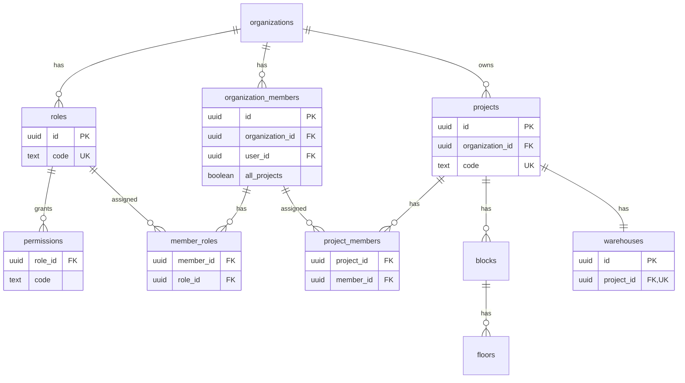

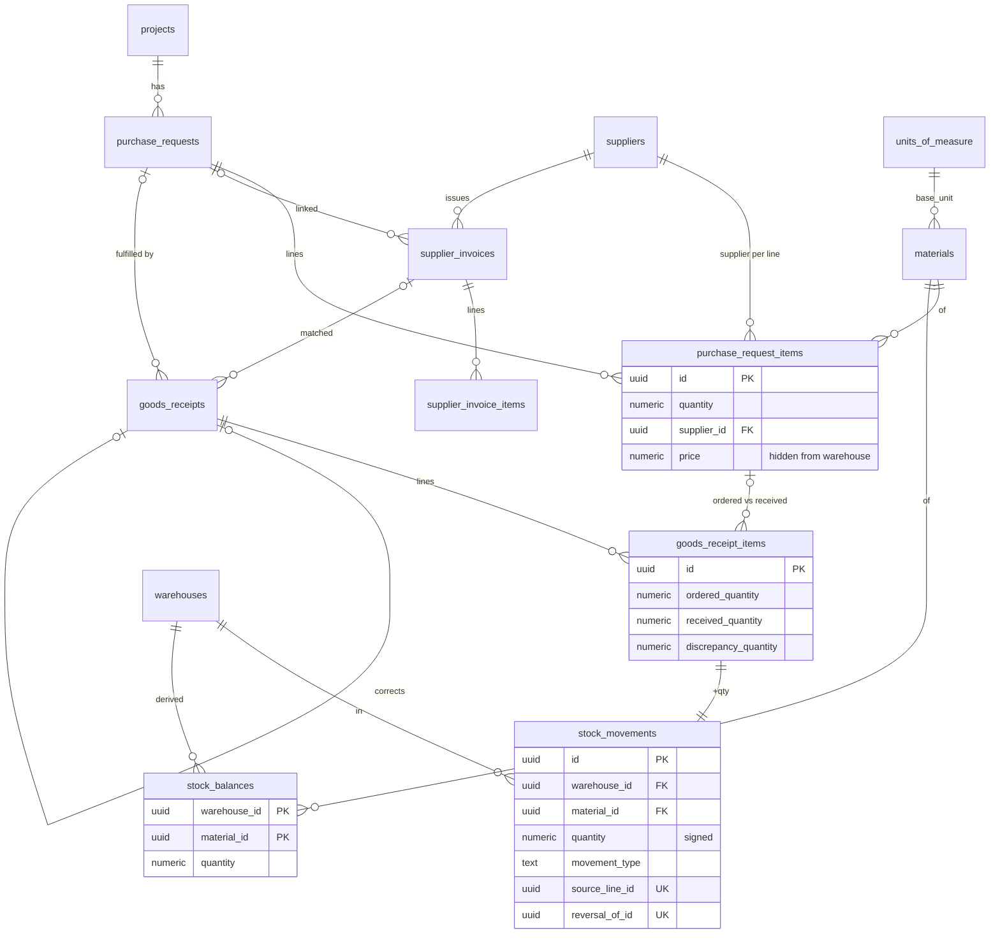

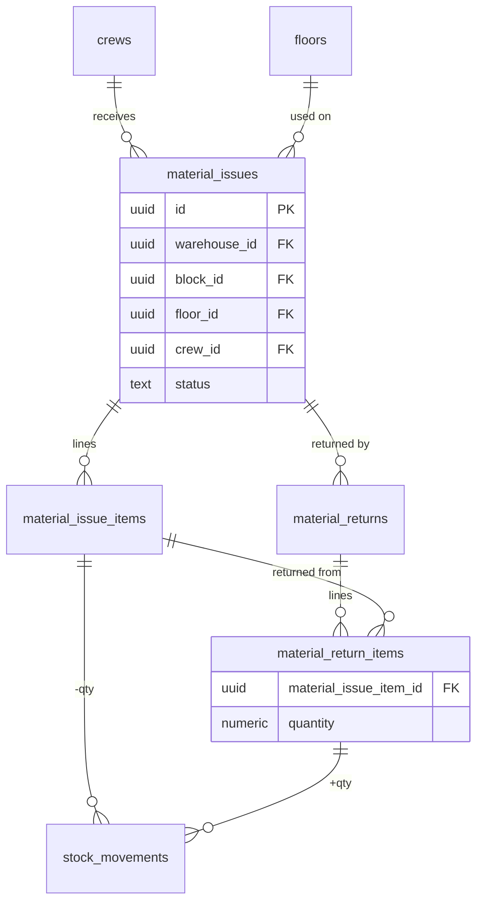

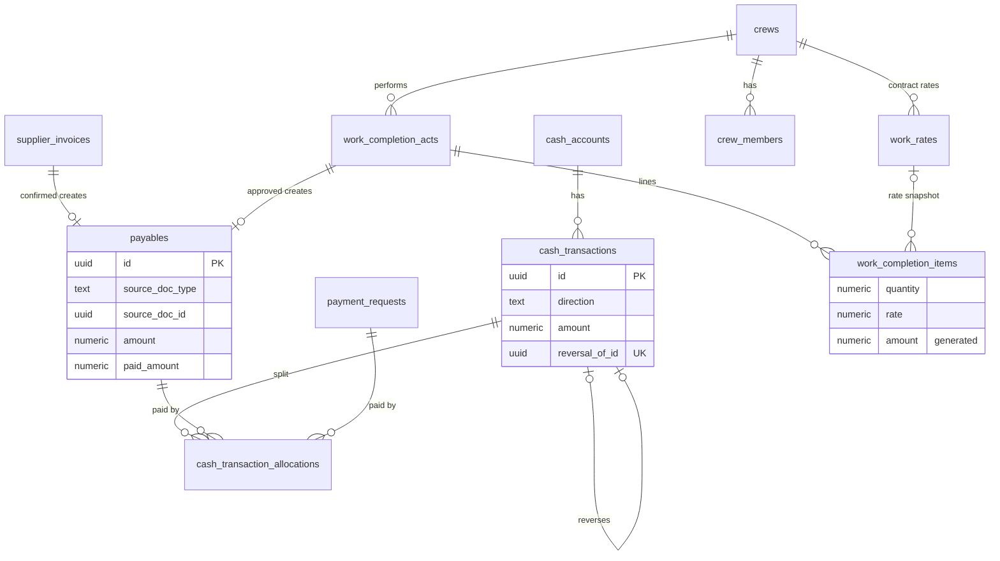

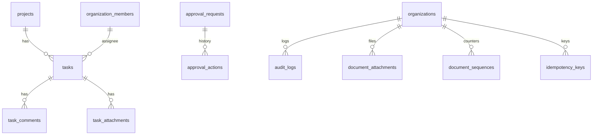

---

## 3. Ролевая модель и каталог прав

Проверка права = **есть право через роль** И (**право без объекта** ИЛИ **участник объекта** ИЛИ `all_projects`).

Каталог кодов (сидируется; матрица меняется данными, не кодом). ✓ — право по умолчанию.

| Код права                                                               | Бух | Склад | Касса | Прораб | Управл | Админ |
| ----------------------------------------------------------------------- | --- | ----- | ----- | ------ | ------ | ----- |
| `projects.view`                                                         | ✓   | ✓     | ✓     | ✓      | ✓      | ✓     |
| `projects.manage` (объекты, блоки, этажи, склады)                       |     |       |       |        | ✓      | ✓     |
| `members.manage` (пользователи, роли, назначения)                       |     |       |       |        |        | ✓     |
| `catalog.manage` (материалы, единицы, поставщики)                       | ✓   |       |       |        |        | ✓     |
| `purchase_requests.view`                                                | ✓   | ✓     |       |        | ✓      |       |
| `purchase_requests.manage` (создать, изменить, выдать, отменить; Д-92)   |     | ✓     |       |        |        |       |
| `purchase_requests.review` (сверка, расхождение, закрытие; Д-92)         | ✓   |       |       |        |        |       |
| `prices.view` 🔒                                                        | ✓   |       |       |        | ✓      |       |
| `supplier_invoices.view` (без цен)                                      | ✓   | ✓     | ✓     |        | ✓      |       |
| `supplier_invoices.manage`                                              | ✓   |       |       |        |        |       |
| `stock.view` (остатки, движения, приёмки, выдачи)                       | ✓   | ✓     |       |        | ✓      |       |
| `stock.view_own_crews` (выдачи/возвраты своих бригад)                   |     |       |       | ✓*     |        |       |
| `goods_receipts.post`                                                   |     | ✓     |       |        |        |       |
| `material_issues.post` (выдачи и возвраты)                              |     | ✓     |       |        |        |       |
| `payables.view`                                                         | ✓   |       | ✓     |        | ✓      |       |
| `payment_requests.create` (прочие расходы, зарплаты, выплаты вне актов) |     |       | ✓     |        |        |       |
| `payment_requests.approve` (OTHER_EXPENSE)                              | ✓   |       |       |        |        |       |
| `payment_requests.approve_payroll` (SALARY, CREW_EXTRA) — TODO(TZ-open) |     |       |       |        |        | ✓     |
| `goods_receipts.approve_correction` (с ACCOUNTING_REVIEW)               | ✓   |       |       |        |        |       |
| `cash.view`                                                             | ✓   |       | ✓     |        | ✓      |       |
| `cash.post`                                                             |     |       | ✓     |        |        |       |
| `cash.reverse`                                                          |     |       | ✓     |        |        |       |
| `cash_accounts.manage`                                                  |     |       | ✓     |        |        | ✓     |
| `crews.view`                                                            | ✓   |       | ✓     | ✓      | ✓      |       |
| `crews.manage` (бригады, тарифы)                                        |     |       |       | ✓      | ✓      |       |
| `work_acts.view`                                                        | ✓   |       | ✓     | ✓      | ✓      |       |
| `work_acts.create`                                                      |     |       |       | ✓      |        |       |
| `work_acts.approve`                                                     |     |       |       |        | ✓      |       |
| `tasks.view`                                                            | ✓   | ✓     | ✓     | ✓      | ✓      |       |
| `tasks.execute` (только назначенные себе)                               |     | ✓     | ✓     | ✓      |        |       |
| `tasks.manage`                                                          |     |       |       |        | ✓      |       |
| `reports.view`                                                          | ✓   |       | ✓     |        | ✓      |       |
| `audit.view` 🔒                                                         | ✓   |       |       |        | ✓      | ✓     |

`*` прораб: «ограниченно» в ТЗ — [Решение] видит выдачи/возвраты **своих бригад** (`crews.foreman_member_id`), без остатков склада.
`all_projects = true` по умолчанию: бухгалтер, кассир, админ. Склад, прораб, управляющий — только по `project_members`.

---

## 4. State machine документов

Общие правила:

- Переход = вызов Postgres-функции (§6). Прямой `UPDATE status` запрещён (column grants + триггер
  `private.guard_status()` проверяет пару `(old,new)` по `private.allowed_transition(doc_type, old, new)` и что
  выставлен флаг транзакции `bf.in_posting = on`, который ставят только функции проведения).
- «Система» = переход внутри функции проведения другого документа.
- Каждый переход пишет `audit_logs`; переходы с согласованием — ещё `approval_actions`.

### 4.1 Заявка (`purchase_requests`)

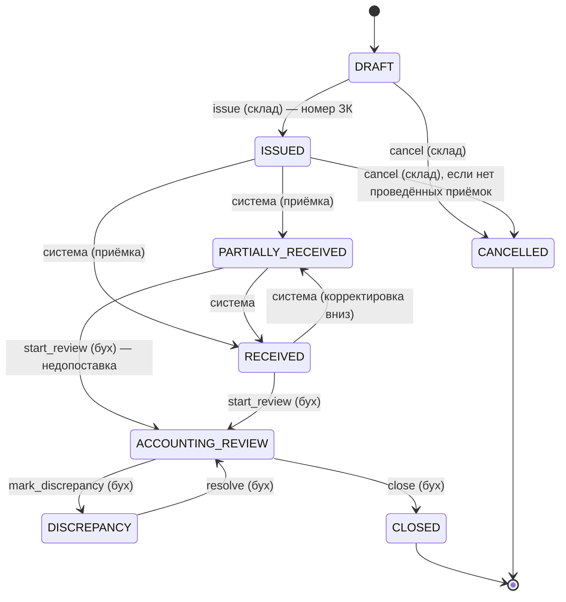

| Переход                      | Кто                        | Условия                                                                                |
| ---------------------------- | -------------------------- | -------------------------------------------------------------------------------------- |
| DRAFT→ISSUED                 | `purchase_requests.manage` | ≥1 строка (поставщика и цены в заявке нет, Д-92)                                       |
| →PARTIALLY_RECEIVED/RECEIVED | система                    | пересчёт по `purchase_request_fulfillment`: все строки `received ≥ ordered` → RECEIVED |
| →ACCOUNTING_REVIEW           | `purchase_requests.review` | нет черновиков приёмок по заявке                                                       |
| →CLOSED                      | `purchase_requests.review` | все связанные накладные CONFIRMED или CANCELLED                                        |
| →DISCREPANCY / обратно       | `purchase_requests.review` | обязательный комментарий; правила разрешения — [TZ-open]                               |
| →CANCELLED                   | `purchase_requests.manage` | из DRAFT/ISSUED без проведённых приёмок                                                |

Приёмка по заявке разрешена в ISSUED / PARTIALLY_RECEIVED / RECEIVED (довоз сверх заказа). В ACCOUNTING_REVIEW, DISCREPANCY, CLOSED, CANCELLED — нет.

### 4.2 Накладная (`supplier_invoices`)

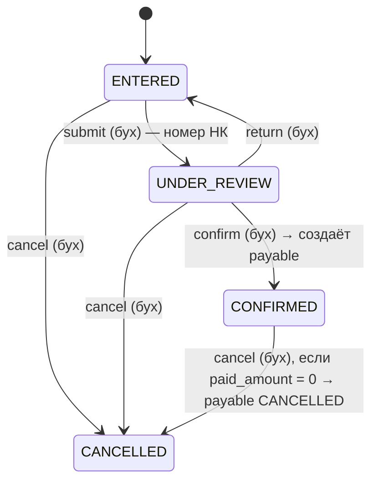

Всё делает `supplier_invoices.manage`. `UNDER_REVIEW` = сверка с приёмками (кол-во). Цены впервые попадают в систему из накладной (Д-92) —
сверять их с заявкой не с чем; заготовка накладной из заявки = принятое от этого поставщика по заявке.
Подтверждение — сверка документа и основание оплаты (Д-13): создаётся `payable` (SUPPLIER), кассир платит без
`payment_request`. Это не согласование: бухгалтер может подтвердить накладную, которую сам ввёл (Д-14).
Строки редактируемы только в ENTERED.

### 4.3 Акт приёмки (`goods_receipts`) — Д-06

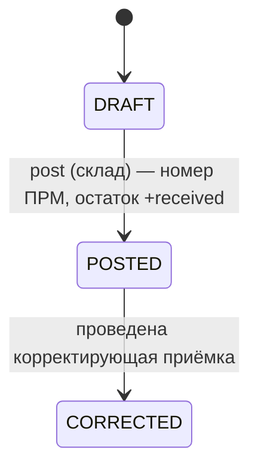

Корректирующая приёмка — новый документ с `corrects_receipt_id` и обязательной `correction_reason`:

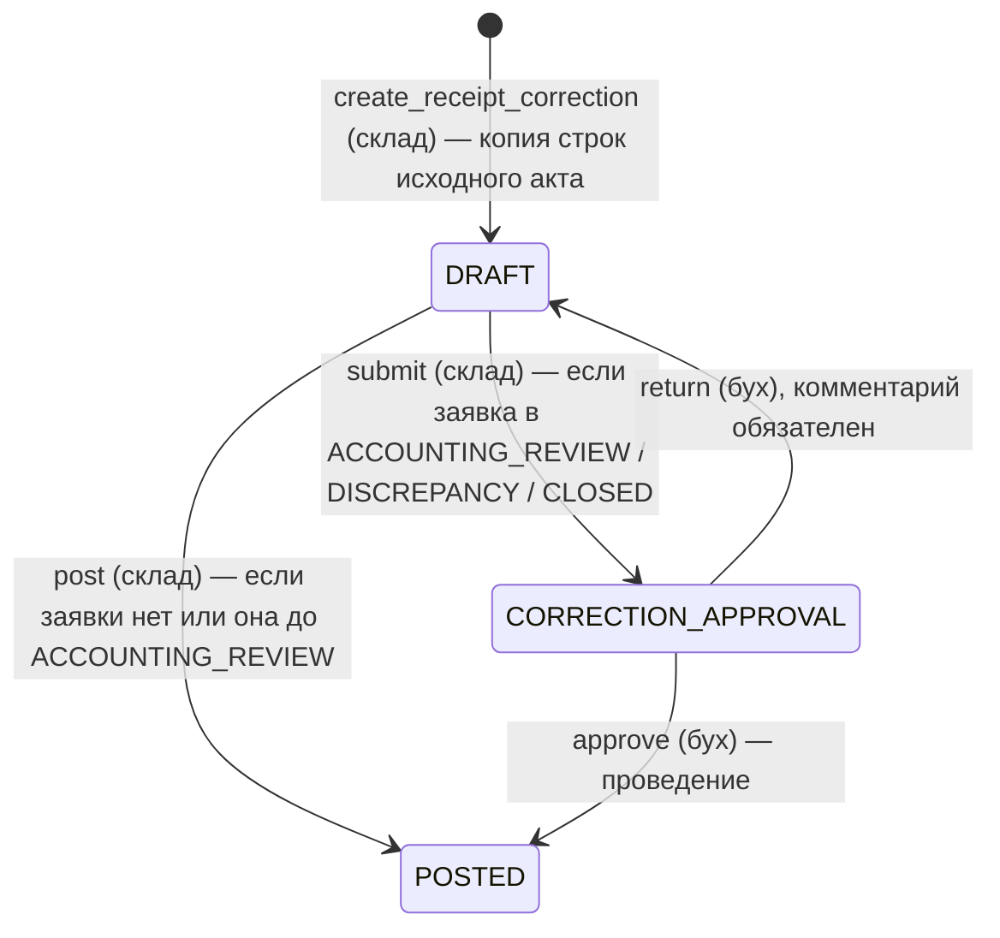

Проведение корректировки в одной транзакции: сторно движений исходного акта (`RECEIPT_REVERSAL`) → новые
`RECEIPT`-движения → исходный акт CORRECTED → пересчёт статуса заявки (только в зоне ISSUED…RECEIVED; статусы
сверки не трогаются автоматически). Если уменьшение уводит остаток в минус — ошибка с текущим остатком (Д-19).
Маршрут (сам/через бухгалтера) определяется статусом заявки **на момент проведения** (под `FOR UPDATE` заявки).
Корректировка до нуля строк = фактическая отмена приёмки.

### 4.4 Выдача и возврат (`material_issues`, `material_returns`)

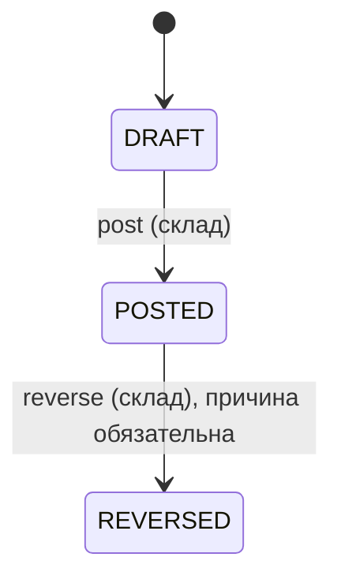

| Документ                       | post                                                               | reverse                                                                   |
| ------------------------------ | ------------------------------------------------------------------ | ------------------------------------------------------------------------- |
| Выдача                         | `ВДЧ`, остаток −qty, проверка ≥ 0                                  | остаток +qty; запрещено, если есть непросторнированные возвраты по выдаче |
| Возврат                        | `ВЗВ`, остаток +qty; Σ возвратов по строке ≤ выдано; выдача POSTED | остаток −qty, проверка ≥ 0                                                |
| Право: `material_issues.post`. |

### 4.5 Счёт на оплату (`payment_requests`) — Д-13

Только расходы **без накладной и вне актов**: OTHER_EXPENSE, SALARY, CREW_EXTRA.

```mermaid
stateDiagram-v2
    [*] --> DRAFT
    DRAFT --> APPROVAL : submit (кассир) — номер СЧ
    APPROVAL --> APPROVED : approve (бух — OTHER_EXPENSE; org_admin — SALARY/CREW_EXTRA)
    APPROVAL --> DRAFT : return, комментарий обязателен (Д-15)
    APPROVED --> PARTIALLY_PAID : система (касса)
    APPROVED --> PAID : система (касса)
    PARTIALLY_PAID --> PAID : система
    PARTIALLY_PAID --> APPROVED : система (сторно кассы)
    PAID --> PARTIALLY_PAID : система (сторно кассы)
    DRAFT --> CANCELLED : cancel
    APPROVAL --> CANCELLED : cancel
    APPROVED --> CANCELLED : cancel, если paid_amount = 0
```

Согласующий ≠ автор (Д-14). Согласование через `approval_requests` с `required_permission`, зависящим от `purpose`.

### 4.6 Акт выполненных работ (`work_completion_acts`)

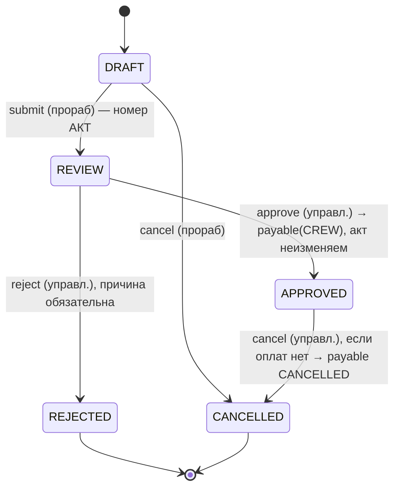

- Согласование бухгалтера не требуется (BP-05). Утверждённый акт — триггер запрещает любые UPDATE строк и сумм.
- Исправление: `copy_work_act(id)` создаёт новый DRAFT с `replaces_act_id` (из REJECTED или после отмены APPROVED).
- Оплата: кассир проводит расход категории CREW_ACT с allocation на payable акта. «Частично оплачен» — производный
  статус из `payables` (в списке статусов акта его нет).

### 4.7 Кассовая операция (`cash_transactions`)

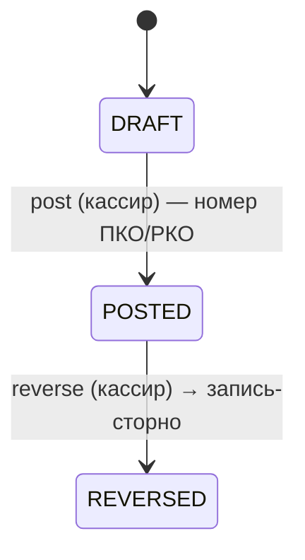

`post`: проверка валюты кассы; неотрицательного остатка кассы (Д-19, ошибка с текущим остатком); для расхода
Σ allocations = сумма, каждая ≤ остатка долга; соответствие категории и основания (Д-13):
SUPPLIER → payable SUPPLIER; CREW_ACT → payable CREW; OTHER_EXPENSE/SALARY/CREW_EXTRA → согласованный счёт того же назначения.
Обновляет `payables.paid_amount/status`, `payment_requests.paid_amount/status`.
`reverse`: создаёт операцию противоположного направления (`reversal_of_id`, POSTED, свой номер), исходная → REVERSED;
её allocations перестают учитываться, кэши долгов откатываются. Кто вправе сторнировать — [TZ-open] (по умолчанию `cash.reverse`).

### 4.8 Задача (`tasks`)

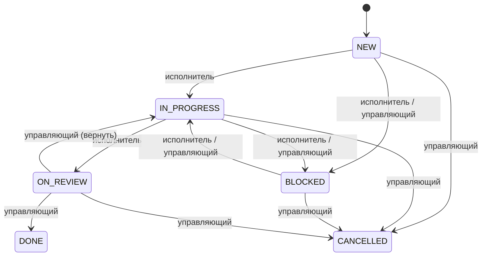

«Исполнитель» = `assignee_member_id` текущего пользователя + `tasks.execute`; «управляющий» = `tasks.manage` на объекте.

---

## 5. Стратегия RLS

### 5.1 Принципы

- RLS включён на **всех** таблицах `public`. Роль `anon` не имеет грантов вообще.
- Права проверяются дважды: в server action (`lib/auth/guard.ts` → `requirePermission()`) и в RLS/функциях.
- Хелперы живут в схеме `private` (не выставлена в PostgREST), `SECURITY DEFINER`, `STABLE`,
  `SET search_path = ''`, `REVOKE EXECUTE FROM public, anon`, `GRANT EXECUTE TO authenticated`.
- `auth.uid()` в хелперах оборачивается в `(select auth.uid())` → вычисляется один раз на запрос (initPlan).
- Индексы под хелперы: `organization_members(user_id)`, `member_roles(member_id)`, `permissions(role_id, code)`,
  `project_members(member_id, project_id)`.

### 5.2 Хелперы

```sql
private.member_id(p_org uuid) returns uuid
  -- активный organization_members.id текущего пользователя в организации, иначе NULL

private.is_member(p_org uuid) returns boolean

private.has_permission(p_org uuid, p_perm text) returns boolean
  -- exists: member (active) → member_roles → permissions.code = p_perm

private.has_project_access(p_org uuid, p_project uuid) returns boolean
  -- member.all_projects OR exists project_members(member, project)

private.can(p_org uuid, p_project uuid, p_perm text) returns boolean
  -- has_permission(p_org, p_perm) AND (p_project IS NULL OR has_project_access(p_org, p_project))

private.is_aal2() returns boolean
  -- (auth.jwt()->>'aal') = 'aal2'

private.requires_mfa(p_org uuid) returns boolean
  -- у участника есть роль org_admin | accountant | cashier (Д-29)
```

`private.can()` дополнительно возвращает false, если `requires_mfa(org) and not is_aal2()` — без второго фактора
привилегированный пользователь не видит и не проводит ничего, кроме своего профиля (RLS + функции).
Middleware приложения перенаправляет такого пользователя на подключение/ввод TOTP.
[Решение] Права не кладём в JWT custom claims: матрица меняется, JWT устареет на час. Если появятся проблемы со
скоростью — кэш прав в claims через Auth Hook с коротким TTL, отдельной задачей.

### 5.3 Шаблон политики (объектная таблица документа)

```sql
alter table public.material_issues enable row level security;

create policy material_issues_select on public.material_issues
  for select to authenticated
  using (
    private.can(organization_id, project_id, 'stock.view')
    or ( private.has_permission(organization_id, 'stock.view_own_crews')   -- прораб «ограниченно»
         and crew_id in (select id from public.crews where foreman_member_id = private.member_id(organization_id)) )
  );

create policy material_issues_insert on public.material_issues
  for insert to authenticated
  with check (private.can(organization_id, project_id, 'material_issues.post') and status = 'DRAFT');

create policy material_issues_update on public.material_issues
  for update to authenticated
  using      (private.can(organization_id, project_id, 'material_issues.post') and status = 'DRAFT')
  with check (private.can(organization_id, project_id, 'material_issues.post') and status = 'DRAFT');

create policy material_issues_delete on public.material_issues
  for delete to authenticated
  using (private.can(organization_id, project_id, 'material_issues.post') and status = 'DRAFT' and number is null);

-- колонки статуса/номера/проведения нельзя менять напрямую:
revoke update on public.material_issues from authenticated;
grant  update (doc_date, note, block_id, floor_id, crew_id, received_by_name) on public.material_issues to authenticated;
```

- Строки документов — те же политики по своим денормализованным `organization_id, project_id` + «редактируемо,
  только пока заголовок в начальном статусе» (триггер, т.к. в RLS это подзапрос).
- Справочники организации (`materials`, `suppliers`, `crews`, `units_of_measure`) — SELECT: `is_member(org)`;
  запись — соответствующий `*.manage`.
- `stock_movements`, `stock_balances`, `payables`, `audit_logs`, `approval_*`, `document_sequences`,
  `idempotency_keys` — **без INSERT/UPDATE/DELETE политик** для `authenticated`: пишут только функции (§6).
- `tasks`: SELECT — `can(..., 'tasks.view')` (видит объект) ИЛИ `assignee = member_id(org)`.
- Storage (`storage.objects`, bucket `documents`): политика разбирает путь
  `(storage.foldername(name))[1]::uuid = org`, `[2] = doc_type`, `[3] = doc_id` и вызывает
  `private.can_view_document(doc_type, doc_id)`.

### 5.4 Скрытие цен от склада (на уровне данных)

Важно: в Supabase все пользователи — одна Postgres-роль `authenticated`, поэтому column grants
не различают бухгалтера и склад сами по себе. Схема:

1. **Цены отсутствуют в складских таблицах по построению**: `goods_receipt_items`, `material_*_items`,
   `stock_movements`, `stock_balances` не содержат денег.
2. **Ценовые колонки** (`purchase_request_items.price/amount`, `supplier_invoice_items.price/amount`,
   `supplier_invoices.total_amount`) закрыты для чтения **всем** через базовую таблицу:
   ```sql
   revoke select on public.purchase_request_items from authenticated;
   grant  select (id, organization_id, project_id, purchase_request_id, line_no, material_id, unit_id,
                  quantity, supplier_id, currency, created_at, created_by, updated_at)
     on public.purchase_request_items to authenticated;
   grant insert, update (price) on public.purchase_request_items to authenticated;  -- запись ограничена RLS-правом manage
   ```
3. **Цены читаются только через view-«витрины»** `public.purchase_request_items_priced`,
   `public.supplier_invoice_items_priced`, `public.supplier_invoices_priced`:
   владелец `postgres`, `security_barrier = true`, внутри явный фильтр
   `where private.can(organization_id, project_id, 'prices.view')`. View владельца обходит RLS базовой
   таблицы — поэтому фильтр повторяет её SELECT-политику целиком (pgTAP проверяет).
4. **Побочные каналы утечки цен** закрыты отдельно:
   `audit_logs` (содержит old/new строк) — только `audit.view`; вложения `SUPPLIER_INVOICE` (сканы с ценами) —
   только `prices.view`; `payables`/`payment_requests`/кассы — у склада нет прав вообще; отчёты считаются
   SQL-функциями с проверкой `prices.view`; PostgREST-агрегаты (`sum()`) не включаем.
5. Следствие для кода: `select('*')` по этим таблицам падает с 42501 → в `queries.ts` всегда явный список колонок.
6. pgTAP: под пользователем-складом `select price from purchase_request_items` → `42501`;
   `select count(*) from purchase_request_items_priced` → 0; под бухгалтером → строки видны.

---

## 6. Проведение документов

### 6.1 Функции

Все действия со сменой статуса — функции в `public` (вызываются из server action через `supabase.rpc`
с JWT пользователя), `SECURITY DEFINER`, `SET search_path = ''`, `volatile`. Внутренние шаги — в `private`.

| Функция                                                                                                                                                             | Документ                        |
| ------------------------------------------------------------------------------------------------------------------------------------------------------------------- | ------------------------------- |
| `issue_purchase_request`, `start_purchase_review`, `mark_purchase_discrepancy`, `resolve_purchase_discrepancy`, `close_purchase_request`, `cancel_purchase_request` | Заявка                          |
| `submit_supplier_invoice`, `return_supplier_invoice`, `confirm_supplier_invoice`, `cancel_supplier_invoice`                                                         | Накладная                       |
| `post_goods_receipt`, `create_receipt_correction`, `submit_receipt_correction`, `approve_receipt_correction`, `return_receipt_correction`                           | Приёмка                         |
| `post_material_issue`, `reverse_material_issue`, `post_material_return`, `reverse_material_return`                                                                  | Выдача/возврат                  |
| `submit_payment_request`, `approve_payment_request`, `return_payment_request`, `cancel_payment_request`                                                             | Счёт (прочие расходы, зарплаты) |
| `post_cash_transaction`, `reverse_cash_transaction`                                                                                                                 | Касса                           |
| `submit_work_act`, `approve_work_act`, `reject_work_act`, `cancel_work_act`, `copy_work_act`                                                                        | Акт работ                       |
| `create_task`, `change_task_status`                                                                                                                                 | Задача                          |
| `recalculate_stock_balances(warehouse_id)`, `check_stock_consistency()`                                                                                             | Сервис (админ)                  |

Общий скелет (на примере выдачи):

```sql
create function public.post_material_issue(p_id uuid, p_idempotency_key uuid)
returns jsonb language plpgsql security definer set search_path = '' as $$
declare v_doc public.material_issues; v_cached jsonb; v_result jsonb;
begin
  -- 1. Документ под блокировкой (сериализует параллельные проведения одного документа)
  select * into v_doc from public.material_issues where id = p_id for update;
  if not found then raise exception using errcode = 'P0002', message = 'BF_NOT_FOUND'; end if;

  -- 2. Идемпотентность: тот же ключ → вернуть сохранённый результат без повторного эффекта
  v_cached := private.idempotency_begin(v_doc.organization_id, p_idempotency_key, 'post_material_issue', p_id);
  if v_cached is not null then return v_cached; end if;

  -- 3. Права (не доверяем приложению)
  if not private.can(v_doc.organization_id, v_doc.project_id, 'material_issues.post') then
    raise exception using errcode = '42501', message = 'BF_FORBIDDEN'; end if;

  -- 4. State machine
  if v_doc.status <> 'DRAFT' then raise exception using errcode = 'P0001', message = 'BF_INVALID_STATUS'; end if;
  perform private.validate_issue_lines(p_id);         -- ≥1 строка, единицы = базовые, материалы активны

  perform set_config('bf.in_posting', 'on', true);    -- разрешает guard-триггерам смену статуса

  -- 5. Движения (строки в порядке material_id — единый порядок блокировок = нет дедлоков)
  insert into public.stock_movements (...) select ..., -quantity, 'ISSUE', 'MATERIAL_ISSUE', p_id, i.id ...
    from public.material_issue_items i where i.material_issue_id = p_id order by i.material_id;

  -- 6. Остатки: upsert с дельтой; при нехватке → BF_NEGATIVE_STOCK,
  --    detail = {"material":"Цемент М400","available":"12.5","required":"20","unit":"меш"} (Д-19)
  perform private.apply_stock_deltas('MATERIAL_ISSUE', p_id);

  -- 7. Статус, номер, кто/когда
  update public.material_issues set status = 'POSTED',
         number = private.next_document_number(organization_id, 'MATERIAL_ISSUE', doc_date),
         posted_at = now(), posted_by = auth.uid()
   where id = p_id returning jsonb_build_object('id', id, 'number', number, 'status', status) into v_result;

  -- 8. Аудит + сохранить результат под ключом
  perform private.audit('POST', 'material_issues', p_id, to_jsonb(v_doc), v_result, p_idempotency_key);
  perform private.idempotency_finish(v_doc.organization_id, p_idempotency_key, v_result);
  return v_result;
end $$;
```

Любая ошибка → откат всей транзакции (движения, остатки, номер, ключ). Коды ошибок `BF_*` маппятся в
русские сообщения в `lib/errors.ts`.

### 6.2 Idempotency key

```sql
idempotency_keys (
  organization_id uuid, key uuid, user_id uuid, operation text, target_id uuid,
  response jsonb NULL, created_at timestamptz default now(),
  PRIMARY KEY (organization_id, key)
)
```

- Ключ генерирует **клиент** (`crypto.randomUUID()`) при открытии формы / показе кнопки «Провести» и шлёт
  при каждом повторе; server action передаёт его в RPC. Двойной клик, повтор после таймаута, ретрай сети → один эффект.
- `idempotency_begin`: `insert ... on conflict do nothing`. Если строка уже есть: та же `operation/target_id/user_id`
  → вернуть `response`; иначе → `BF_IDEMPOTENCY_KEY_REUSED`. Параллельный дубль ждёт на уникальном индексе до
  коммита первого и затем получает сохранённый ответ.
- Три уровня защиты от двойного проведения: (1) ключ; (2) `FOR UPDATE` + проверка статуса;
  (3) `UNIQUE (source_line_id, movement_type)` в `stock_movements` и `UNIQUE (reversal_of_id)`.
- Ключи не удаляются в MVP (объём мизерный); чистка старше 90 дней — позже через pg_cron.

### 6.3 Сторно

- Проведённое не удаляется и не редактируется. Сторно = **новые** движения/операции с обратным знаком и
  `reversal_of_id` → исходный документ получает статус REVERSED / CORRECTED, причина обязательна.
- Склад: `ISSUE_REVERSAL`, `RETURN_REVERSAL`, `RECEIPT_REVERSAL` — по одному на исходное движение.
- Касса: запись-сторно — отдельная `cash_transaction` (противоположное направление, свой номер ПКО/РКО).
- Обязательства: отмена накладной/акта → `payables.status = CANCELLED` только при `paid_amount = 0`; иначе
  сначала сторнируются оплаты.
- Всё фиксируется в `audit_logs` с `idempotency_key`.

### 6.4 Остатки (`stock_balances`)

- Инкрементально в той же транзакции: `private.apply_stock_deltas` делает
  `insert ... on conflict (warehouse_id, material_id) do update set quantity = stock_balances.quantity + excluded.quantity`.
  Upsert берёт блокировку строки остатка → параллельные выдачи одного материала сериализуются, «двойной» выдачи не будет.
- Отрицательный остаток запрещён (Д-19): функция проверяет остаток до upsert и бросает `BF_NEGATIVE_STOCK` с
  текущим остатком в `detail`; `CHECK quantity >= 0` — последний рубеж. То же для кассы: `BF_NEGATIVE_CASH` с
  остатком кассы (строка `cash_accounts` блокируется `FOR UPDATE` на время проведения).
- `recalculate_stock_balances(warehouse_id)` — полный пересчёт из `stock_movements` под
  `pg_advisory_xact_lock` по складу (функции проведения берут ту же блокировку в shared-режиме).
- `check_stock_consistency()` — возвращает расхождения «балансы vs Σ движений»; используется в pgTAP и в
  ночной проверке (pg_cron → запись в `audit_logs` при расхождении).
- Начальные остатки (формула ТЗ: «начальный + …») — движения `OPENING` через сервисную функцию
  `post_opening_balance` (право админа/бухгалтера); формы документа в ТЗ нет — §8 П-12.
- Те же принципы (кэш + функция сверки) — для `payables.paid_amount` и `payment_requests.paid_amount`.

### 6.5 Где проверяется что

| Слой                 | Что                                                                     |
| -------------------- | ----------------------------------------------------------------------- |
| zod (клиент+сервер)  | формат, обязательность, положительность, ≤ 4 знаков                     |
| server action        | сессия, `requirePermission`, idempotency key, вызов RPC, маппинг ошибок |
| RLS                  | видимость строк и прямые изменения черновиков                           |
| Функции проведения   | права, state machine, бизнес-инварианты, атомарность                    |
| Constraints/триггеры | последний рубеж: CHECK, UNIQUE, FK, append-only, неизменяемость         |

---

## 7. Нумерация документов

- Формат: `{ПРЕФИКС}-{ГГГГ}-{NNNNNN}`, напр. `ЗК-2026-000123`. Счётчик — на (организация, тип, год);
  год — из `doc_date` в часовом поясе организации; с 1 января счёт с 000001.
- Префиксы [Решение]:

| Документ                    | Префикс | Номер присваивается при                                   |
| --------------------------- | ------- | --------------------------------------------------------- |
| Заявка                      | ЗК      | DRAFT→ISSUED                                              |
| Накладная                   | НК      | ENTERED→UNDER_REVIEW (номер поставщика хранится отдельно) |
| Акт приёмки                 | ПРМ     | проведении                                                |
| Выдача                      | ВДЧ     | проведении                                                |
| Возврат                     | ВЗВ     | проведении                                                |
| Счёт на оплату              | СЧ      | DRAFT→APPROVAL                                            |
| Приходная кассовая операция | ПКО     | проведении                                                |
| Расходная кассовая операция | РКО     | проведении (в т.ч. запись-сторно)                         |
| Акт выполненных работ       | АКТ     | DRAFT→REVIEW                                              |
| Задача                      | ЗД      | создании                                                  |

- Реализация: `document_sequences (organization_id, doc_type, year, last_value)`;
  `private.next_document_number()` делает `insert … on conflict do update set last_value = last_value + 1 returning`
  **внутри транзакции проведения**. Откат проведения откатывает и счётчик → **номера без пропусков**.
  Черновики живут без номера (в UI — «Черновик от 12.10.2026»), их можно удалять, не создавая дыр.
- Строка счётчика блокируется до конца транзакции — при наших объёмах (десятки документов в минуту) это не узкое место.
- Почему не `sequence`: Postgres-последовательности не откатываются и дают дыры.
- ПКО и РКО — отдельные счётчики (обычная практика кассовой дисциплины); `doc_type` в `document_sequences`
  для них — `CASH_IN` / `CASH_OUT`.

---

## 8. Противоречия и пробелы в ТЗ

> Решения по всем пунктам зафиксированы в `docs/DECISIONS.md`; ниже — исходная постановка.

### 8.1 Противоречия

| #    | Где                         | Суть                                                                                                                                          | Что предлагаю                                                                                            |
| ---- | --------------------------- | --------------------------------------------------------------------------------------------------------------------------------------------- | -------------------------------------------------------------------------------------------------------- |
| П-1  | Шапка PDF / CLAUDE.md       | Файл называется `TZ_v1.0`, внутри «Версия 0.9», в конце «затем утвердить версию 1.0»; CLAUDE.md ссылается на `docs/TZ_v0.9.pdf`, которого нет | Положить PDF в `docs/` под одним именем и поправить ссылку в CLAUDE.md                                   |
| П-2  | §6 ТЗ vs CLAUDE.md          | «Схема подлежит сопоставлению с уже существующими таблицами BuildFlow» vs «проект с нуля»                                                     | Следую CLAUDE.md и вашей инструкции — сопоставление не делаю                                             |
| П-3  | §2 vs §3                    | У прораба в ролях есть «счета», в RBAC «Платежи» у прораба — «—»                                                                              | Прораб счета не создаёт; акт работ = основание оплаты бригаде. Подтвердите                               |
| П-4  | §4 vs §5                    | Статусы заявки: англ. — 8 (есть DISCREPANCY), рус. — 7 (расхождения нет)                                                                      | Беру 8 статусов из §4                                                                                    |
| П-5  | §4 BP-02 vs §5              | «Подтверждённая приёмка увеличивает остаток», но у акта приёмки нет статуса «подтверждён»                                                     | Считаю «подтверждена» = «проведена»                                                                      |
| П-6  | §6                          | Есть и `payments`, и `cash_transaction_allocations` — одна оплата хранилась бы дважды                                                         | `payments` — view над allocations (§2.6)                                                                 |
| П-7  | §8 US-01 vs §10             | US-01 (P0) «возможна печать», а «PDF-документы» — P1                                                                                          | В P0 — печатная HTML-версия (print CSS), PDF-генерация — в P1                                            |
| П-8  | §3 «Работы бригад» vs BP-05 | Кассир в RBAC — «Просмотр», но по BP-05 он оплачивает акты                                                                                    | Кассир видит утверждённые акты и проводит оплату через кассу (право `cash.post`)                         |
| П-9  | §8 стр. 3–4                 | Критерии приёмки US-07 и US-08 пустые, их текст оказался в конце §11                                                                          | Беру: US-07 «акт направлен управляющему на утверждение», US-08 «после утверждения акт поступает кассиру» |
| П-10 | §2 vs §11                   | Управляющий «создаёт объекты», но «кто назначает управляющих» — открытый вопрос                                                               | Создатель объекта автоматически становится его участником; назначения — админ                            |

### 8.2 Пробелы (решаю минимально; нужно подтвердить)

| #    | Пробел                                                                        | Моё решение по умолчанию                                                                                                                    |
| ---- | ----------------------------------------------------------------------------- | ------------------------------------------------------------------------------------------------------------------------------------------- |
| П-11 | Можно ли уходить в минус на складе / в кассе                                  | Запрещено (CHECK ≥ 0); настраиваемо позже                                                                                                   |
| П-12 | Ввод начальных остатков склада и касс                                         | Склад — движение `OPENING` сервисной функцией; касса — `opening_balance` счёта                                                              |
| П-13 | Нет статуса «отклонён» у счёта на оплату                                      | Добавляю переход APPROVAL→DRAFT («вернуть на доработку») с комментарием; отмена — CANCELLED                                                 |
| П-14 | Кто создаёт счёт на оплату                                                    | Бухгалтер; согласует тоже бухгалтер. Самосогласование разрешено? — **вопрос**                                                               |
| П-15 | Какие расходы требуют согласования                                            | MATERIALS/SERVICES — только против согласованного счёта; CREW — против утверждённого акта; SALARY/OTHER — без согласования, `TODO(TZ-open)` |
| П-16 | Видимость объектов для бухгалтера/кассира                                     | `all_projects = true` у их членства по умолчанию                                                                                            |
| П-17 | Прораб «ограниченно» на выдачах                                               | Только чтение выдач/возвратов своих бригад                                                                                                  |
| П-18 | Склад/кассир «ограниченно» на накладных                                       | Заголовок и строки без цен; кассир видит суммы через `payables`                                                                             |
| П-19 | Привилегированные роли для MFA                                                | Предлагаю: `org_admin`, `accountant`, `cashier` — проводящие действия требуют `aal2`                                                        |
| П-20 | Блок и этаж в выдаче обязательны (US-03), но бывают общеплощадочные материалы | Обязательны, как в ТЗ; если нужно «общее» — заведём блок «Общее»                                                                            |
| П-21 | Пересчёт единиц измерения                                                     | Нет: одна базовая единица на материал                                                                                                       |
| П-22 | Мультивалютность                                                              | Валюта хранится везде, но оплата обязательства — только в его валюте; курсов нет                                                            |
| П-23 | Склад на объект: ровно один?                                                  | `UNIQUE(project_id)`; снимем, если нужно несколько                                                                                          |
| П-24 | Накладная на несколько объектов                                               | Одна накладная = один объект                                                                                                                |
| П-25 | Безразрывная нумерация                                                        | Да, номер при проведении (§7)                                                                                                               |
| П-26 | Отчёты: состав не описан                                                      | Базовые: остатки, движения материала, долги поставщикам, долги бригадам, движение по кассам; CSV/XLSX — уточнить, P0 или P1                 |
| П-27 | Пересечение периодов тарифов                                                  | Предлагаю EXCLUDE-ограничение (расширение `btree_gist`)                                                                                     |
| П-28 | Утверждённый акт отменяем?                                                    | Да, управляющим, только если не оплачен                                                                                                     |

### 8.3 Открытые вопросы ТЗ (§11) — как они отражены в модели

| Вопрос                            | Заложено                                                                                          |
| --------------------------------- | ------------------------------------------------------------------------------------------------- |
| Расхождения заказ/приёмка         | хранятся `ordered/received/discrepancy`, статус DISCREPANCY; правила разрешения — `TODO(TZ-open)` |
| Метод оценки списания             | в движениях нет стоимости; оценка — будущий отчёт поверх движений + цен накладных                 |
| Инвентаризация, недостачи/излишки | тип движения `ADJUSTMENT` зарезервирован, документа нет                                           |
| Авансы и переплаты                | `CHECK paid_amount <= amount`; аванс = будущий payable без источника                              |
| Переводы между кассами            | не реализуются; направление IN/OUT позволяет добавить TRANSFER позже                              |
| Кто утверждает выплаты бригадам   | утверждение акта управляющим = основание; доп. согласование — нет                                 |
| Возвраты денег, ошибочные платежи | только сторно кассовой операции                                                                   |
| Кто назначает управляющих         | `members.manage` (админ)                                                                          |
| Формы документов                  | печатные формы — P1                                                                               |
| Импорт истории, offline           | не входит; `OPENING`-движения и `opening_balance` покрывают старт                                 |

---

## 9. Реализовано в Foundation (миграция `20261012010000_foundation.sql`)

Таблицы §2.1–2.3 (кроме складских движений), §2.8 (`audit_logs`, `document_sequences`), хелперы §5.2, нумерация §7.
Отличия от §2 и дополнения:

| Что | Где | Зачем |
|---|---|---|
| `organization_members.email`, `invited_at`, `invited_by` | §2.1 | список участников без доступа к `auth.users`; кто и когда пригласил |
| Склад создаётся триггером при создании объекта; автор объекта — его участник | §2.2, Д-22, Д-28 | у объекта всегда ровно один склад |
| `public.my_access()` | RPC | организации, роли, права (с учётом MFA), объекты текущего пользователя — для гарда и меню |
| `public.current_user_requires_mfa()` | RPC | для `proxy.ts` и входа (Д-42) |
| `public.create_organization(...)` | RPC, только `service_role` | `npm run org:create` (Д-41) |
| `public.find_user_id_by_email(...)` | RPC, только `service_role` | приглашение человека с существующей учётной записью |
| `public.add_member`, `update_member`, `set_member_roles`, `set_member_projects` | RPC, проверяют `members.manage` | доступ и роли меняются только через функции (прямой записи в `member_roles`/`project_members` нет) |
| `private.permission_catalog()` | функция | матрица прав по умолчанию (§3 с Д-13, Д-26), засеивается в каждую новую организацию |
| `private.audit_row()` | триггер на всех таблицах Foundation | INSERT/UPDATE/DELETE со снимками old/new и автором |
| `private.before_update_std()` | триггер | `updated_at`; неизменяемость `id`, `organization_id`, `project_id`, `created_*` (второй рубеж после колоночных грантов, Д-40) |

Гранты (Д-40): `authenticated` получает только перечисленное в разделе 14 миграции; `document_sequences` недоступна,
`audit_logs` — только SELECT (RLS: `audit.view`). Покрыто `supabase/tests/database/010_foundation.test.sql` (36 проверок).

## 10. Фаза 1.5 (миграция `20261013000000_mfa_reset.sql`)

| Что | Зачем |
|---|---|
| `private.session_alive()`; проверка в `private.member_id()` и `public.my_access()` | права только при живой сессии (Д-47) |
| `public.reset_member_mfa(member_id, reason)` | сброс MFA администратором (Д-45): aal2, не себе, причина, аудит |
| `public.reset_user_mfa_by_service(email, reason)` — только `service_role` | `npm run mfa:reset` (Д-46) |
| `public.member_mfa_status(org)` | статус второго фактора в списке участников (`auth.mfa_factors` клиенту недоступна) |
| `private.reset_mfa(...)` | общая часть: факторы, сессии, `MFA_RESET` в аудит всех организаций пользователя |

Восстановление пароля: `/forgot-password` → письмо (`supabase/templates/recovery.html`) → `/auth/confirm` →
`/reset-password` → проверка MFA (Д-49). Покрыто `supabase/tests/database/020_mfa_reset.test.sql` (19 проверок).

## 11. Фаза 2 — закупки и склад (миграции `20261014000000…000200`)

**Инфраструктура проведения** (`_posting_core`): `idempotency_keys` + `private.idempotency_begin/finish`;
`private.guard_document()` (статус/номер/проведение — только при `bf.in_posting`, переходы — по
`private.allowed_transition`); `private.guard_lines()` (строки — только в начальном статусе);
`stock_movements` (append-only) и `stock_balances`; `private.add_movement` → `private.apply_movements(ids)` →
`private.apply_balance_delta` (минус → `BF_NEGATIVE_STOCK` с остатком в detail, Д-19, Д-59);
`check_stock_consistency(org)`; `recalculate_stock_balances(warehouse)` (service_role); Д-21 — триггер на
`materials.unit_id`.

**Документы** — запись только функциями (Д-58):

| Документ | Черновик | Переходы |
|---|---|---|
| Заявка | `save_purchase_request_draft` | `issue_ / cancel_ / start_purchase_review / mark_ / resolve_purchase_discrepancy / close_` |
| Накладная | `save_supplier_invoice_draft` | `submit_ / return_ / confirm_ (→ payable) / cancel_supplier_invoice` |
| Приёмка | `save_goods_receipt_draft` | `post_goods_receipt`, `create_ / submit_ / approve_ / return_receipt_correction` |
| Выдача | `save_material_issue_draft` | `post_ / reverse_material_issue` |
| Возврат | `save_material_return_draft` | `post_ / reverse_material_return` |
| Любой черновик | `delete_document_draft` | — |

Все переходы принимают `p_key` (idempotency key). Цены: колонки `price/amount/total_amount` недоступны через
таблицы; `*_priced` views с `prices.view`. Вложения: `add_document_attachment` + политики `storage.objects` (Д-60).
`purchase_request_fulfillment` — заказано/принято/осталось/расхождение по строке (без цен, `security_invoker`).

Тесты: pgTAP `030_procurement` (26), `040_warehouse` (54), `050_prices` (27); интеграционные
`tests/integration` (параллельность, цены через REST/Storage); E2E `procurement-warehouse.spec.ts`.

## 12. Фаза 3 — финансы и ввод остатков (миграции `20261015000000…000200`)

**Отличия от §2.6:** у `cash_accounts` нет `opening_balance/opening_date` — начальный баланс вводится документом
«Ввод остатков» (Д-61); есть кэш `balance` (Д-62). У `cash_transactions` добавлены `kind` (REGULAR / REVERSAL /
OPENING, Д-65) и `opening_balance_id`; категория `OPENING_BALANCE`. У `payables` — `basis` (основание введённого долга)
и FK на объект. `payments` — представление (Д-11).

| Документ | Черновик | Переходы |
|---|---|---|
| Кассовая операция | `save_cash_transaction_draft` (распределения в JSON) | `post_cash_transaction`, `reverse_cash_transaction` |
| Счёт на оплату | `save_payment_request_draft` | `submit_ / approve_ / return_ / cancel_payment_request` (согласующий по назначению, Д-13; ≠ автор, Д-14) |
| Ввод остатков | `save_opening_balance_draft` | `post_opening_balance`, `reverse_opening_balance` |
| Касса | `save_cash_account` | — |

Проведение расхода (Д-63, Д-64): Σ распределений = сумма; основание по категории; блокировки «операция →
обязательства/счета → касса»; `BF_OVERPAYMENT` / `BF_NEGATIVE_CASH` с цифрами в detail. Сторно: запись
противоположного направления (свой номер), исходная → REVERSED, кэши пересчитываются из распределений.
Ввод остатков: склад — движения `OPENING` (сторно `OPENING_REVERSAL`); кассы — операции `kind = OPENING`;
долги — обязательства с источником `OPENING_BALANCE` (сторно — только без оплат).

Приватность: кассы/операции/распределения — `cash.view`; счета — `payment_requests.view`; обязательства —
`payables.view`; денежный ввод остатков — `opening_balances.manage` / `cash.view` / `payables.view`.
Тесты: pgTAP `060_finance` (46), `070_opening` (27), `080_finance_privacy` (8); интеграционные
`finance-concurrency.test.ts`; E2E `finance.spec.ts`.

## 13. Изменение Д-67 — согласование сторно кассы (миграция `20261016000000_cash_reversal_approval.sql`)

- `cash_transactions`: `reversal_requested_by/at`, `reversal_reason`, `reversal_approved_by/at`;
  CHECK `reversal_approved_by <> reversal_requested_by`.
- Поток: кассир `request_cash_reversal(id, key, reason)` → запрос (`approval_requests`, требуемое право
  `cash.reverse_approve`) → бухгалтер `approve_cash_reversal` (вызывает `private.reverse_cash_tx`) или
  `reject_cash_reversal` (комментарий обязателен, запрос снимается). Ошибки: `BF_REVERSAL_PENDING`,
  `BF_NO_REVERSAL_REQUEST`, `BF_SELF_APPROVAL`. Всё идемпотентно по ключу.
- `reverse_cash_transaction` удалена — сторнировать в одиночку нельзя никому.
- Отчёт `cash_reversals_report(org, from, to)` → страница `/finance/reversals` (бухгалтер, org_admin).
- В журнале операций — фильтр «Сторно: на согласовании».

## 14. Фаза 4 — бригады, акты работ, задачи, отчёты (миграции `20261017000000…000200`)

**Схема**
- `crew_members` — состав бригады (люди, не пользователи); `work_rates` — история тарифов (Д-69, Д-70).
- `work_completion_acts` + `work_completion_items` — §2.7; снимок тарифа в строке; `total_amount` — кэш триггером.
- `tasks`, `task_comments` (append-only); `task_attachments` — представление над `document_attachments` (Д-77).

**Функции**

| Функция | Назначение |
|---|---|
| `save_work_rate` | тариф с даты (`work_rates.manage`) |
| `save_work_act_draft`, `delete_work_act_draft` | черновик акта; тариф подставляет БД, `BF_NO_RATE` |
| `submit_ / approve_ / reject_ / cancel_work_act` | переходы §4.6 через `private.work_act_transition`; идемпотентны; утверждение создаёт payable CREW |
| `copy_work_act` | «Создать на основе» (Д-72) |
| `work_act_duplicates` | предупреждение о дубле (Д-73) |
| `save_task`, `change_task_status`, `add_task_comment`, `task_assignees` | задачи §4.8 (Д-74) |
| `report_stock_balances`, `report_material_issues`, `report_payables`, `report_cash`, `report_work_acts` | отчёты, `SECURITY INVOKER` (Д-75) |

**Защита**
- Утверждённый акт неизменяем: `guard_lines` (строки — только в DRAFT) + `guard_work_act` (у утверждённого
  меняются только поля отмены; удаляется только черновик). CHECK: утвердил/отклонил ≠ автор.
- Параллельные утверждения сериализуются блокировкой строки акта; обязательство одно —
  `UNIQUE(source_doc_type, source_doc_id)` в `payables`.
- `private.allowed_transition` дополнен актами и задачами; статус задачи меняет только функция (`guard_document`).

**Права (изменения матрицы §3)**
- `work_rates.manage` — управляющий.
- `work_acts.view_approved` — кассир (вместо `work_acts.view`).
- `tasks.view` снято у склада, кассира и прораба — они видят только свои задачи через `tasks.execute`.

**Приложение**
- `/crews/acts` — акты, mobile-first форма прораба, карточка с действиями.
- `/crews/teams` — бригады, состав, тарифы.
- `/tasks` — задачи с подсветкой просрочки, крупными кнопками переходов, фото и обсуждением.
- `/reports/<вид>` — отчёты с экспортом `/reports/<вид>/export?format=csv|xlsx`.
- Оплата бригадам: `/finance/pay/crew/[crewId]` — та же форма долга, категория CREW_ACT.

## 15. Фаза 5 — Pilot & Hardening (миграции `20261018000000…000100`)

- **Ограничение частоты** (Д-80): `private.rate_limits`, `public.rate_limit_hit` (только service_role);
  `src/lib/security/rate-limit.ts` — вход, «забыли пароль», экспорт, вложения, импорт, health.
- **Заголовки и CSP** (Д-81): `src/lib/security/headers.ts`, `src/proxy.ts`; корневой layout динамический.
- **Мониторинг** (Д-83, Д-84): `instrumentation.ts`, `instrumentation-client.ts`, скраббер
  `src/lib/observability/scrub.ts`; `/api/health` + `public.health()`; `.github/workflows/uptime.yml`.
- **Бэкап** (Д-82): `.github/workflows/backup.yml`, `scripts/backup/{dump,restore-verify}.sh`,
  `scripts/backup/sql/{table-counts,reconcile}.sql`, `scripts/ci/normalize-db-url.py`.
- **Импорт справочников** (Д-85): `public.import_catalog`, `src/features/catalog/import/*`, `/catalog/import`.
- **Тесты**: pgTAP `120_security` (инварианты RLS/грантов/search_path для всех объектов), `130_import`;
  E2E `csp.spec.ts`, `catalog-import.spec.ts`; smoke staging (`playwright.smoke.config.ts`).
- **Документы**: `RUNBOOK.md`, `BACKUP_RESTORE.md`, `SECURITY_REVIEW.md`, `USER_GUIDE.md`,
  `RECONCILIATION_SCENARIO.md`, `PILOT_QUESTIONS.md`, `PILOT_READINESS.md`.

## 16. Вход без писем (миграция `20261019000000_login_accounts.sql`, Д-87…Д-90)

- `private.user_logins (login PK, user_id UNIQUE)` — логин (телефон `992XXXXXXXXX` или имя латиницей), уникален во всём
  BuildFlow; учётная запись Auth — на `<логин>@login.buildflow.internal`; `organization_members.email` — необязательный.
- Создание сотрудника: `prepare_member_account` (проверка, admin aal2) → admin API `createUser` (временный пароль,
  `app_metadata.must_change_password`) → `register_login` (service_role) → `add_member`; ошибка — удаление учётной записи.
- Сброс: `prepare_password_reset` → admin API `updateUserById` → `complete_password_reset` (сессии, аудит `PASSWORD_RESET`);
  скрипт — `reset_user_password_by_service` + `npm run password:reset`.
- Обязательная смена: proxy (`PASSWORD_CHANGE_PATHS`), `private.must_change_password()` в `member_id()`/`my_access()`,
  `setPassword` снимает признак admin API и обновляет сессию.
- MFA: `private.requires_mfa`, `current_user_requires_mfa` — только `org_admin`, `cashier`.
- Удалено: приглашения по email, `/forgot-password`, `/reset-password`, `/auth/confirm`, шаблоны писем.

## 17. Второй фактор по настройке организации (миграция `20261020000000_mfa_optional.sql`, Д-91)

- `organizations.mfa_enforced boolean not null default false`; на запись клиенту закрыта (грант UPDATE — по колонкам).
- `private.requires_mfa`, `current_user_requires_mfa` — роль `org_admin`/`cashier` **и** `mfa_enforced`; через них же —
  `has_permission`, `my_access`, proxy, `redirectAfterAuth`, layout (код приложения не менялся).
- `private.require_admin_aal2`, `reset_member_mfa` — aal2 только при `requires_mfa`.
- Тесты: pgTAP `150_mfa_optional` (оба режима); `010`, `020`, `080`, `140`, интеграционные и E2E — режим «включён»
  (`seed-local --enforce-mfa`, `seedLocal({ enforceMfa: true })`).

## 18. Работа внутри объекта (Д-94, Д-95; миграция `20261022000000_allocation_same_project.sql`)

- Маршруты: `/` — выбор объекта (карточки доступных по RLS объектов) и «Общее по организации»;
  `/objects/[projectId]/…` — объектные разделы: `procurement`, `warehouse`, `finance`, `acts`, `tasks`, `reports`.
  Склад (Д-98): `warehouse/requests` (заявки склада, широкая колонка) и `warehouse/(stock)/…` (остатки, журнал,
  операции — узкая колонка); «Закупки» — `procurement/invoices` (затраты) и `procurement/approvals`.
  Общие — по своим адресам: `/finance` (касса без объекта), `/reports` (по всем объектам), `/crews` (бригады,
  тарифы), `/opening`, `/projects`, `/catalog`, `/admin/*`. Старые адреса объектных разделов → `/` (`next.config` redirects).
- `src/app/(app)/objects/[projectId]/layout.tsx` → `requireObject()` (`features/projects/object.ts`): объект виден
  пользователю и из текущей организации, иначе 404; `ObjectProvider` даёт client-компонентам объект
  (`useObject`, `useObjectHref`, `ObjectLink`). Документ другого объекта по адресу этого — redirect на его адрес
  (`ensureDocInObject`). Ссылки — `objectHref()` (`lib/routes.ts`); после изменений — `revalidateApp()`.
- Меню: `OBJECT_NAV` / `COMMON_NAV` (`components/layout/nav-items.ts`), контекст — по адресу (`objectIdFromPath`).
- Финансы — одна реализация страниц (`features/finance/pages`), route-файлы в обоих деревьях — реэкспорт;
  область (`features/finance/scope.ts`): объект — его операции, долги, счета; кассы — объекта и общие;
  `/finance` — `project_id IS NULL`, только общие кассы. Отчёты — `features/reports/components/report-views.tsx`:
  внутри объекта — только отчёты с разрезом по объекту (`byProject`), параметр `project` — из адреса.
- Д-95 (БД): `private.validate_and_lock_allocations` — `payable/payment_request.project_id IS NOT DISTINCT FROM
  cash_transactions.project_id`, иначе `BF_ALLOCATION_PROJECT`. Тест — pgTAP `060_finance`.

## 19. Скорость переходов (Д-96)

- Vercel: вход на краю сети (для Таджикистана — `arn1`, Стокгольм), функции — `bom1` (Мумбаи) рядом с БД
  (Supabase `ap-south-1`). `proxy.ts` выполняется на краю — в нём **нет обращений к БД** (только локальная
  проверка JWT, ES256 + кэш JWKS); всё, что требует БД, — в Server Components/Actions в `bom1`.
- MFA-редирект — в `src/app/(app)/layout.tsx` (`?next=` из `x-pathname`, который ставит proxy).
- `loading.tsx` (`components/page-skeleton.tsx`) — рядом с каждой `page.tsx` в `(app)`: новые страницы — с ним же.
- `experimental.staleTimes.dynamic = 30` в `next.config.ts`; после изменений — `revalidateApp()`.

## 20. Журнал затрат (Д-97; миграция `20261023000000_expenses.sql`)

- `expense_categories` (STD; `name`, `color` — ключ палитры `features/catalog/expense-colors.ts`, `via_warehouse`,
  `sort_order`, `is_active`; RLS: чтение — участники, запись — `catalog.manage`). Стартовые пять — у всех организаций
  и триггером `seed_expense_categories` на `organizations` (новые).
- `supplier_invoices.category_id` (FK на категорию той же организации); `supplier_doc_number/date` — NULL допустимы.
- `public.save_expense_row(...)` — строка затрат = накладная из одной строки: новая → `CONFIRMED` + номер НК +
  `payables`; существующая без оплат → временный переход `CONFIRMED → ENTERED` (обход `guard_lines`) → правка →
  `CONFIRMED`, обновление обязательства; с оплатой — `BF_HAS_PAYMENTS`. Идемпотентно (`idempotency_begin`).
  Новые переходы в `private.allowed_transition`: `ENTERED → CONFIRMED`, `CONFIRMED → ENTERED` (только в проведении).
- UI: `features/procurement/components/expenses-grid.tsx`; общая логика фильтров/итогов/вставки —
  `features/procurement/expenses.ts` (и экран, и выгрузка `…/procurement/invoices/export`). Тест — pgTAP `160_expenses`.

